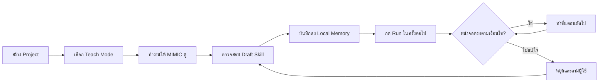
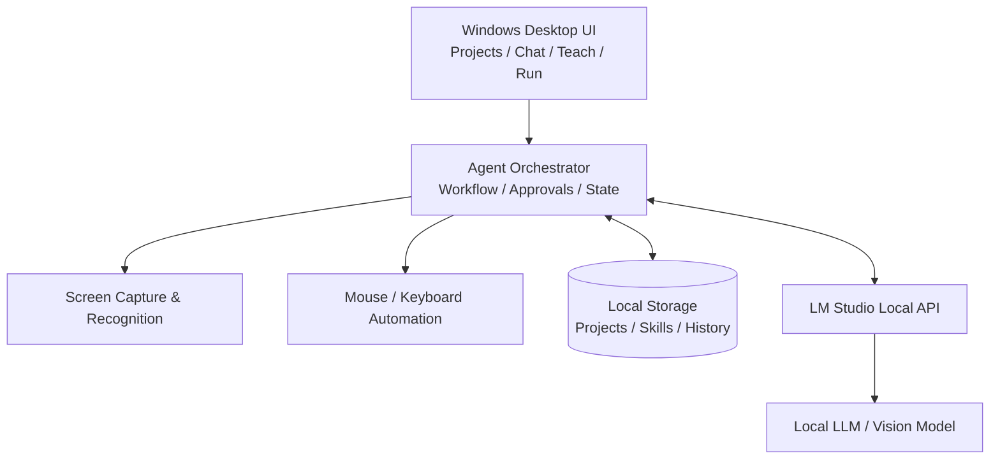

<div align="center">

# ✨ MIMIC

### Your Personal Local AI Assistant

**สอนให้ดูครั้งเดียว • จดจำเป็นทักษะ • เรียกใช้ซ้ำเมื่อพร้อม**

*Teach it. Remember it. Let it help.*


**[แนวคิด](#-mimic-คืออะไร)** · **[ประสบการณ์ใช้งาน](#-วิธีใช้งานที่เรากำลังออกแบบ)** · **[หน้าตาแอป](#-แนวทางหน้าตาโปรแกรม)** · **[สถาปัตยกรรม](#-สถาปัตยกรรมเบื้องต้น)** · **[Roadmap](#-development-roadmap)**

</div>

---

> [!IMPORTANT]
> **MIMIC ยังอยู่ในขั้นออกแบบ (Concept / Planning)** — README นี้อธิบาย **วิสัยทัศน์และฟีเจอร์ที่วางแผนจะสร้าง** ไม่ได้หมายความว่าความสามารถดังกล่าวพัฒนาเสร็จหรือใช้งานได้แล้ว

## 🎯 Immediate milestone — MIMIC v0.1 (No AI Automation)

**We are implementing deterministic Windows desktop automation before AI teaching.** The application should launch an explicitly allowed EXE, locate known UI states, take scoped actions, verify the result, and stop when a screen is unexpected — **without opening LM Studio**. The first target is a controlled demo application, not a commercial game.

**Development handoff:** [Automation MVP specification](docs/AUTOMATION_MVP_V01.md) · [Workflow contract](docs/WORKFLOW_CONTRACT_V01.md) · [Prompt for Gemini](docs/PROMPT_GEMINI_AUTOMATION_V01.md)

> This is a **planned milestone**. Actual screen control, credential entry, workflow execution and multi-profile sequencing are not yet implemented. Any real-game automation must respect service rules and technical restrictions.

---

## 🛠️ Current codebase — v0.1 UI Scaffold

> The repository now includes an **early desktop application source scaffold**, not a completed autonomous assistant. It has **not yet been verified on the target Windows computer**.

- **Desktop shell:** Tauri 2 + React + TypeScript + Vite (provisional; may be changed following Phase 0)
- **Available UI:** Home, Project creation/selection, Workspace, Skills/Teach placeholders, Settings
- **Local AI bridge:** narrow Rust commands for LM Studio model detection and text chat at `127.0.0.1:1234`
- **Not implemented:** screen capture, computer control, teaching/recording, skill replay, voice, or game automation
- **Safety:** automation buttons remain disabled until genuinely implemented and verified

**Getting started:** [Windows setup & run instructions](docs/GETTING_STARTED.md) · [Architecture](docs/ARCHITECTURE.md) · [Implementation status](docs/IMPLEMENTATION_STATUS.md)

```powershell
npm install
npm run dev
```

> Requires Node.js, Rust and Windows native build tools. LM Studio must be running with a model to use text chat.

---

## 🧠 MIMIC คืออะไร

**MIMIC** คือโปรแกรมผู้ช่วย AI ส่วนตัวสำหรับ Windows ที่ตั้งใจให้เรา **พูดหรือพิมพ์สั่งงาน → สอนด้วยการทำให้ดู → บันทึกเป็นความจำและขั้นตอน → ให้ผู้ช่วยทำซ้ำบนคอมพิวเตอร์ได้** โดยใช้โมเดล AI ที่ทำงานในเครื่องผ่าน **LM Studio** เป็นหลัก

ไม่ใช่แค่ Macro ที่จำตำแหน่งเมาส์: เป้าหมายคือให้ MIMIC ตรวจสอบสถานการณ์บนหน้าจอ รู้ว่างานขั้นตอนไหนเสร็จแล้ว และ **หยุดถามเจ้าของเครื่อง** เมื่อไม่แน่ใจ แทนที่จะคลิกเดาสุ่ม

### หลักการสำคัญ

| | ความสามารถที่ออกแบบไว้ | แนวคิด |
|:--:|---|---|
| 🗂️ | **Projects** | แยกพื้นที่และบริบทของแต่ละงาน |
| 👀 | **Screen Awareness** | เห็นหน้าต่างเป้าหมายและประเมินสถานะหน้าจอ |
| 🎬 | **Teach Mode** | บันทึกการสาธิต พร้อมคำอธิบายจากผู้ใช้ |
| 🧩 | **Reusable Skills** | เปลี่ยนตัวอย่างเป็น Workflow ที่ตรวจสอบและแก้ไขได้ |
| 💬 | **Ask When Unsure** | แสดงภาพหน้าจอและถามเมื่อเจอเงื่อนไขใหม่ |
| 💾 | **Persistent Memory** | เก็บ Skills, ภาพตัวอย่าง และประวัติไว้บน SSD |
| ▶️ | **Run / Pause / Stop** | ให้ผู้ใช้เป็นผู้ควบคุมการทำงานเสมอ |
| 🔒 | **Local-first** | ตั้งใจให้ประมวลผลและเก็บข้อมูลหลักไว้ในเครื่อง |

## 🚀 วิธีใช้งานที่เรากำลังออกแบบ



**ตัวอย่าง: Project งานประจำบน Windows**

1. สร้าง Project ใหม่และตั้งชื่อ
2. กด **Teach** แล้วพูดหรือพิมพ์ว่า “ดูผมนะ เดี๋ยวสอนขั้นตอนนี้”
3. ทำงานจริงให้ดู เช่น เปิดโปรแกรม ปิดหน้าต่างที่ไม่จำเป็น และคลิกตามลำดับ
4. MIMIC บันทึกภาพ เหตุการณ์ และคำอธิบาย แล้วเสนอ **Draft Skill** ให้ตรวจสอบ
5. บันทึก Skill ลงเครื่อง; วันถัดมาเลือก Project แล้วกด **Run**
6. หากหน้าต่างไม่เหมือนเดิม ระบบตรวจสอบใหม่ หรือ **หยุดพร้อมภาพประกอบเพื่อถามผู้ใช้**

> การสาธิตครั้งเดียว **ไม่ได้ทำให้โมเดลเรียนรู้ได้ทุกสถานการณ์โดยอัตโนมัติ** ความแม่นยำขึ้นกับการตรวจจับภาพ เงื่อนไข Workflow และการทดสอบซ้ำ

## 🖥️ แนวทางหน้าตาโปรแกรม

หน้าจอหลักที่วางแผนไว้จะมี **Project Sidebar**, **Live Screen**, **Chat / Voice** และแถบควบคุม **Teach / Run / Pause / Stop**

```text
┌────────────────────────────────────────────────────────────────────────────────┐
│  ✨ MIMIC                                       ● Local AI      Settings ⚙       │
├──────────────────┬─────────────────────────────────────┬───────────────────────┤
│ PROJECTS         │ LIVE SCREEN                         │ MIMIC CHAT            │
│                  │                                     │                       │
│ + New Project    │   [Selected Windows App Preview]    │ MIMIC: พร้อมช่วยครับ  │
│                  │                                     │                       │
│ • My Workflow    │   Screen status: Observing          │ You: ดูผมนะ...        │
│ • Game Routine   │                                     │                       │
│ • Daily Tasks    │                                     │ [?] เจอหน้าต่างใหม่   │
│                  │                                     │ ต้องทำอย่างไรต่อ?     │
│ SKILLS           │                                     │                       │
│ • Open App       │                                     │ [ พิมพ์ข้อความ... ]   │
│ • Daily Routine  │                                     │ [🎤] [Send]           │
├──────────────────┴─────────────────────────────────────┴───────────────────────┤
│  [● Teach]       [▶ Run]       [Ⅱ Pause]       [■ Stop]       [Emergency Stop] │
└────────────────────────────────────────────────────────────────────────────────┘
```

*ภาพด้านบนเป็น Wireframe เพื่ออธิบายทิศทาง UI ไม่ใช่ภาพหน้าจอของแอปที่ทำเสร็จแล้ว*

### ประสบการณ์ที่อยากให้เกิดขึ้น

> **You:** “มิมิก เริ่มทำงานที่สอนไว้เมื่อวานให้หน่อย”  
> **MIMIC:** “รับทราบครับ กำลังตรวจสอบหน้าต่างและเริ่มขั้นตอนแรก”  
> **MIMIC:** “พบหน้าต่างที่ไม่เคยเจอ ผมหยุดไว้ก่อน ต้องปิดหรือดำเนินการต่อครับ?”  
> **You:** “ปิดหน้านี้ แล้วทำต่อ จำไว้ใช้ครั้งต่อไปด้วย”  
> **MIMIC:** “ผมจะบันทึกเป็นข้อเสนอแก้ไข Skill ให้คุณยืนยันก่อนครับ”

## 🏗️ สถาปัตยกรรมเบื้องต้น



- **LM Studio** ใช้ให้โปรแกรมส่งคำสั่งไปยังโมเดลในเครื่อง; ไม่ได้ควบคุม Windows ให้เองโดยตรง
- **Automation Layer** เป็นตัวใช้เมาส์และคีย์บอร์ดจริง ภายใต้นโยบายอนุญาตและขั้นตอนที่ตรวจสอบได้
- **Memory** เน้นเก็บข้อมูลและ Skills ในเครื่อง ไม่ใช่ฝึกน้ำหนักโมเดลทุกครั้งที่สอน
- **Vision** ต้องเลือกและทดสอบโมเดลที่รองรับภาพจริง; LLM แบบข้อความอย่างเดียวไม่สามารถดู Screenshot ได้
- **Voice** เป็นส่วนขยายที่วางแผนไว้ โดยอาจใช้ Speech-to-Text แบบ Local

## 🛡️ ความปลอดภัยและขอบเขต

- มี **Pause / Stop / Emergency Stop** เพื่อคืนการควบคุมให้ผู้ใช้ทันที
- เมื่อไม่แน่ใจหรือผลไม่ตรงเงื่อนไข ให้ **หยุดถาม** ไม่คลิกสุ่มหรือทำงานต่อแบบคาดเดา
- การส่งข้อความ การซื้อ การลบไฟล์ หรือการกระทำที่มีผลสำคัญ ต้องมีการขออนุมัติ
- **ไม่บันทึกรหัสผ่านเป็นภาพหรือข้อความดิบโดยไม่จำเป็น**; ใช้การจัดเก็บความลับอย่างปลอดภัยเมื่อจำเป็น
- Local-first ไม่เท่ากับ Offline เสมอไป; ต้องตรวจสอบและปิดการเชื่อมต่อภายนอกตามความต้องการจริง
- การใช้งานกับแอปหรือเกมของบุคคลที่สามต้องคำนึงถึงข้อกำหนดของแต่ละบริการ

## 🗺️ Development Roadmap

| Phase | เป้าหมาย | สถานะ |
|---|---|---|
| **01 · Foundation** | Windows app, Projects, Chat, เชื่อม LM Studio | Planned |
| **02 · Observe** | เลือกหน้าต่าง, Capture, วิเคราะห์ภาพหน้าจอ | Planned |
| **03 · Teach** | Record actions, Draft Skills, Review & Save | Planned |
| **04 · Execute** | Run Skills, ตรวจสอบผล, Pause / Stop | Planned |
| **05 · Learn with Feedback** | ถามเมื่อไม่แน่ใจ, แก้ Skill, เก็บตัวอย่างใหม่ | Planned |
| **06 · Voice & Extensions** | Voice interaction, ระบบ Plugin/เครื่องมือเฉพาะทาง | Future |

## 💻 Development Environment (เป้าหมายเริ่มต้น)

| Component | Environment |
|---|---|
| OS | Windows 11 |
| CPU | AMD Ryzen 9 9900X |
| GPU | NVIDIA RTX 5070 Ti · 16 GB VRAM |
| RAM | 32 GB |
| Local AI | LM Studio |
| API | OpenAI-compatible local endpoint (ตามการตั้งค่าเครื่อง) |
| Data | Local SSD / project-specific storage |

> สถาปัตยกรรม เฟรมเวิร์ก UI และโมเดล Vision รุ่นสุดท้ายยังต้องทดสอบก่อนตัดสินใจ

## 📌 Current Status

โครงการนี้ยังอยู่ในช่วงกำหนดขอบเขตและเตรียมสร้าง **MVP** จึงยังไม่มีคำสั่งติดตั้งหรือ Run ที่ยืนยันว่าใช้ได้จริง และยังไม่ควรประกาศว่าเปิดใช้งานอัตโนมัติได้แล้ว

**Next milestone:** สร้าง Windows UI ขั้นพื้นฐาน เชื่อม Local AI และพิสูจน์การ Capture หน้าต่างเป้าหมายได้จริง

---

<div align="center">

**MIMIC — Teach once. Guide, verify, and reuse.**

*Built around your workflow, running on your machine.*

</div>
